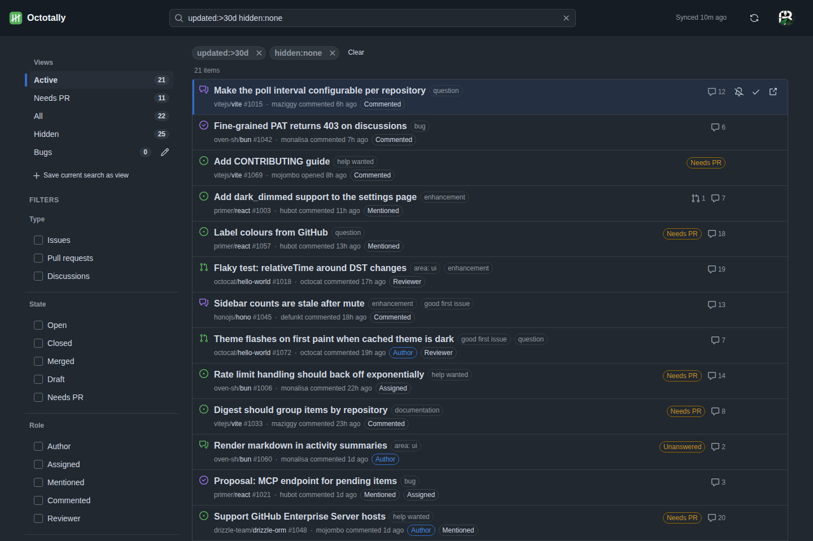
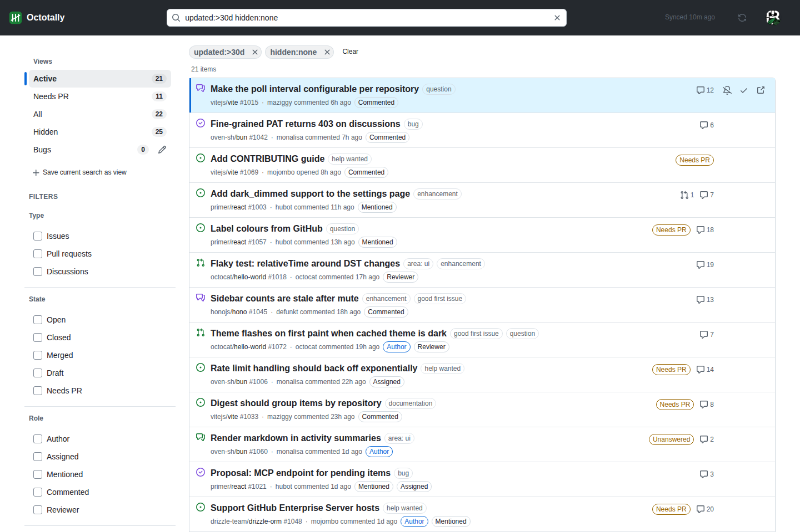
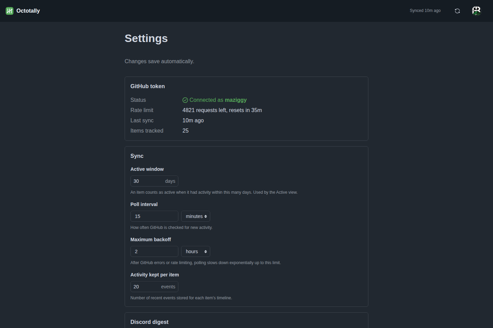

# Octotally

**Every GitHub issue, pull request and discussion you are part of, on one page, filtered to what
still needs you.**

Octotally polls GitHub for everything that `involves:` you, keeps it in a small SQLite database and
shows it as a single GitHub-style list: active threads (replies in the last N days), open items that
still have no linked PR, your own backlog. Mark items done or mute them until something new happens,
search with GitHub qualifiers plus relative dates, and get a Discord digest of what moved. It reads
from GitHub with a read-only token and ships as one container.

| Dashboard (dark dimmed) | Dashboard (light) | Settings |
|---|---|---|
|  |  |  |

Features, configuration, search syntax, API and operations are documented in [`docs/`](docs/);
the design is in [`docs/SDD.md`](docs/SDD.md).

## Requirements

- Docker with the Compose plugin (the image is published for `linux/amd64` and `linux/arm64`), or
  [Bun](https://bun.sh) ≥ 1.3 to run from source.
- A GitHub personal access token. Octotally never writes to GitHub, so read-only is enough:
  - **Fine-grained token** (GitHub → Settings → Developer settings → Fine-grained tokens):
    repository access *All repositories* or a selection; repository permissions, read-only:
    **Issues**, **Pull requests**, **Discussions**, **Metadata**. A fine-grained token only sees
    the owner and organisations it was granted, so for involvement across many organisations a
    classic token is simpler.
  - **Classic token**: scopes `repo` (or `public_repo`) and `read:discussion`.
- Optional: a Discord webhook for the digest, a reverse proxy that authenticates users if you do
  not want to use the built-in password.

## Setup

```sh
mkdir octotally && cd octotally
curl -fsSLO https://raw.githubusercontent.com/rojosinalma/octotally/main/compose.yaml
curl -fsSL https://raw.githubusercontent.com/rojosinalma/octotally/main/.env.example -o .env
# edit .env: paste GITHUB_TOKEN, set AUTH_PASSWORD unless a reverse proxy does auth
docker compose up -d
```

Open http://localhost:3000. The first poll runs at start; items appear within a minute. The image
is `ghcr.io/rojosinalma/octotally` (`latest`, `vX.Y`, `vX.Y.Z`); it runs as a non-root user and
stores everything under `/data`. Everything else — poll interval, active window, digest, theme — is
set on the Settings page; see [`docs/configuration.md`](docs/configuration.md).

## License

[AGPL-3.0](LICENSE). Run it, change it, share it — and if you serve a modified version to others
over a network, offer them the source.
