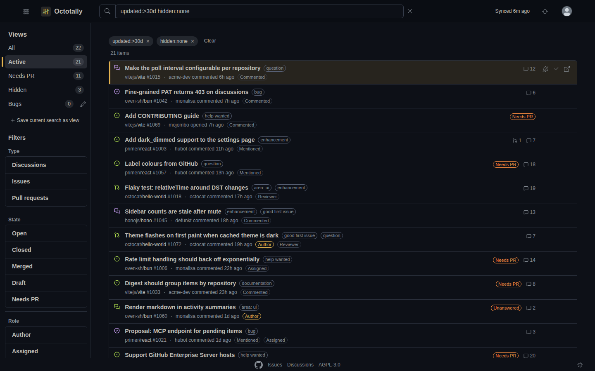
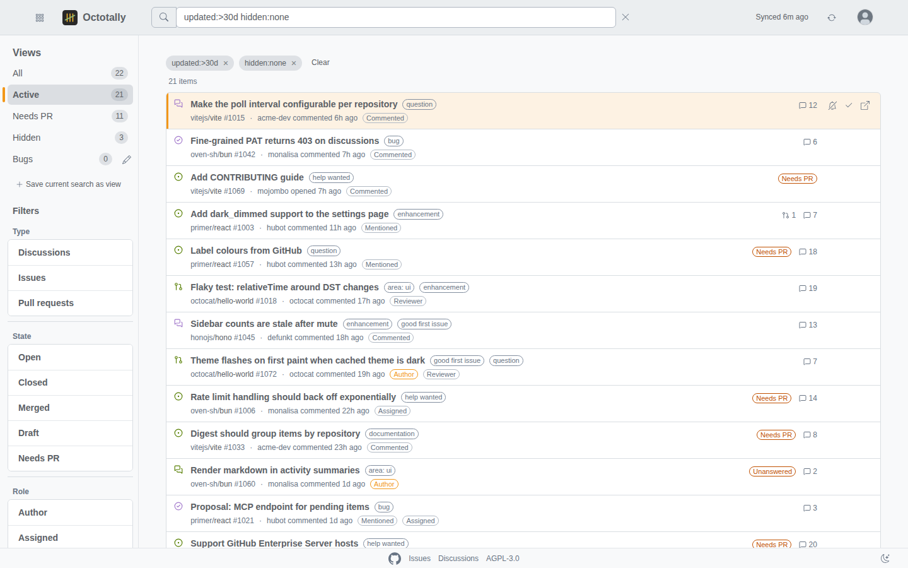
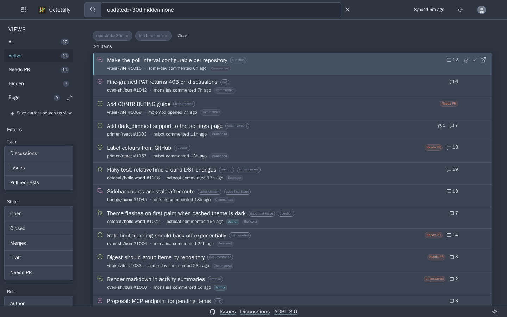
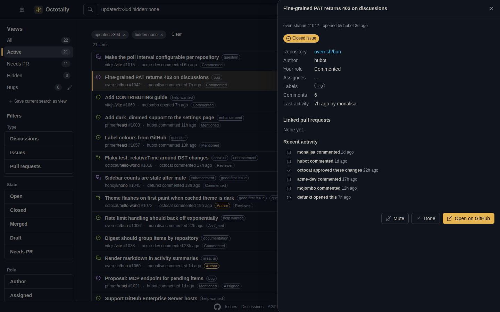
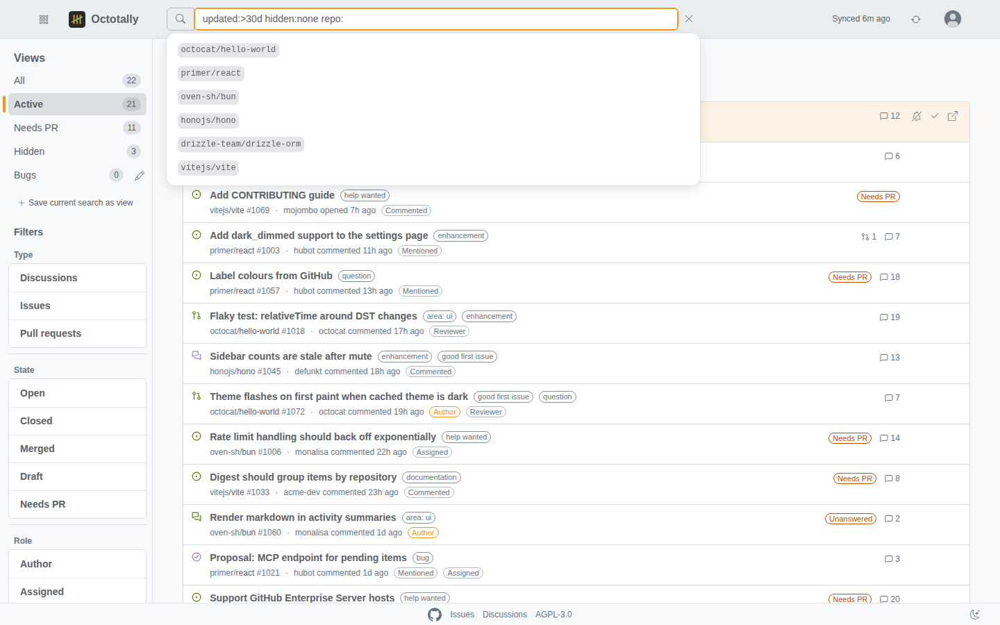
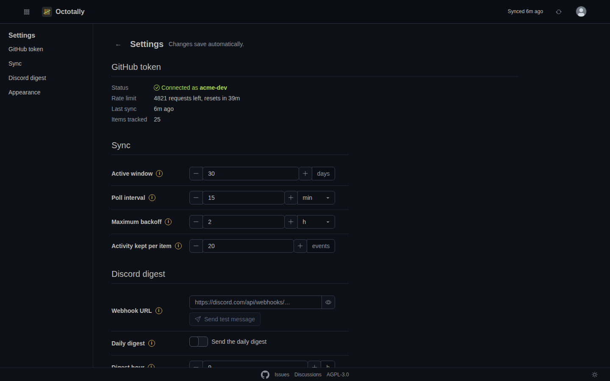
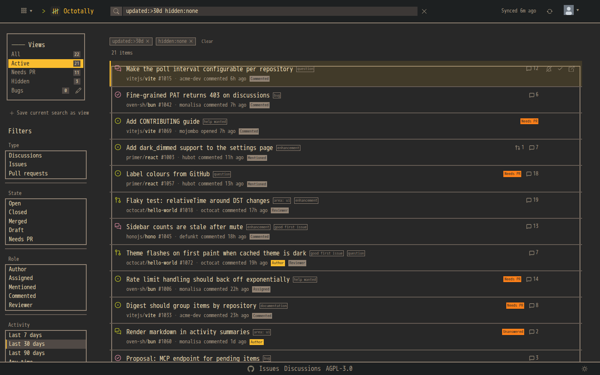
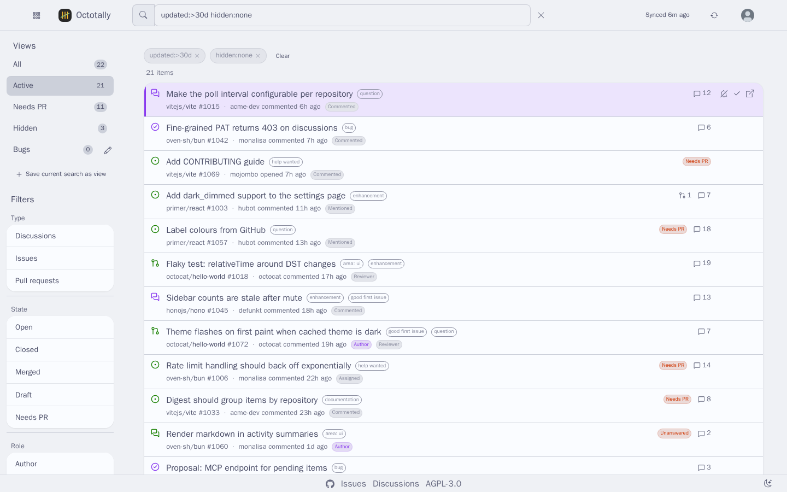

# Features

## What Octotally adds to GitHub

- GitHub's own pages split issues, pull requests and discussions into three dashboards, and
  discussions have no "involves me" page at all.
- Their date filters are absolute (`updated:>2026-01-01`), so a saved "last two weeks" link goes
  stale the day after you bookmark it.
- The notifications inbox is a stream, not a backlog: once you clear it, the open issue nobody
  answered is gone from view.

Octotally is the missing fourth view: one list, relative dates, a backlog that stays until you
decide it is done.

## Feature list

- Issues, pull requests **and** discussions from every repository your token can see
- Built-in views: **Active** (activity in the last N days), **Needs PR** (open, nothing linked),
  **All**, **Hidden**; custom views are saved searches ([search.md](search.md))
- GitHub-compatible search syntax with relative dates (`updated:>14d`), roles (`role:mentioned`),
  linked PRs (`-linked:pr`) and local state (`hidden:muted`)
- **Done** and **Mute** per item; a muted item comes back by itself when new activity arrives
- Item panel with the latest activity, labels, assignees and linked PRs
- Discord digest: daily at a chosen hour and/or near-real-time pings ([notifications.md](notifications.md))
- **Bulk actions**: a checkbox on every row (Shift+click checks a range) and a select-all box above
  the list; the bar shows Done, Mute, Restore and Clear for the checked items. More than 20 items ask
  first
- Toasts only for failures and warnings; a successful action just updates the list
- Keyboard first: `j`/`k` move, `e` done, `m` mute, `o` open on GitHub, `/` search, `?` help, `s` / `Shift+A` select, `Esc` clears the selection
- Every [tailor](https://github.com/rojosinalma/tailor) skin and palette, in dark and light; the GitHub look (`primer` skin) by default, following the OS ([themes.md](themes.md))
- JSON API for scripts and agents ([api.md](api.md)), `/health` for monitors ([operations.md](operations.md))
- Rate-limit aware poller with backoff; cached data is served while GitHub is down

## Screenshots

| Dashboard (Primer, dark) | Dashboard (Primer, light) | Dashboard (Pico, Nord) |
|---|---|---|
|  |  |  |

| Item panel | Search autocomplete | Settings |
|---|---|---|
|  |  |  |

| Terminal look (WebTUI, Gruvbox) | daisyUI, Catppuccin, light |
|---|---|
|  |  |
